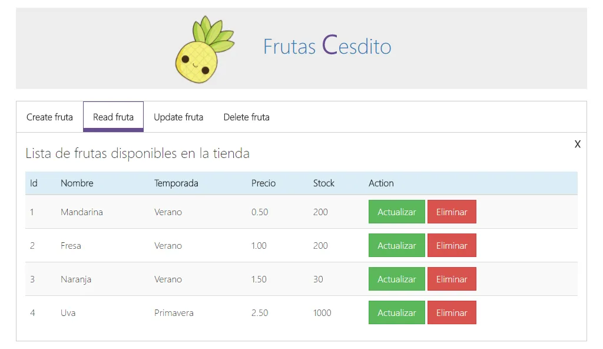

---
# Metainformació del document
title: Laravel 
titlepage: true
subtitle: Ejercicio de clase
author:
- Pepe Devesa
...

Vamos a agilizar nuestra técnica:
Vamos a crear un ejemplo desde cero, en concreto, el ejercicio es una aplicación web de frutas donde realizaremos un CRUD, trabajaremos con un base de datos relacional, en este caso MySQL.

Tendremos que crear para la tabala _Fruta_:

* controladores
* migracion
* modelo
* faker con solo nombres de frutas
* control de acceso
* añadir el campo imagen
* Por supuesto, plantillas.

:::note
La imagen es orientativa, por supuesto, dejar rienda suelta a la creatividad.
:::