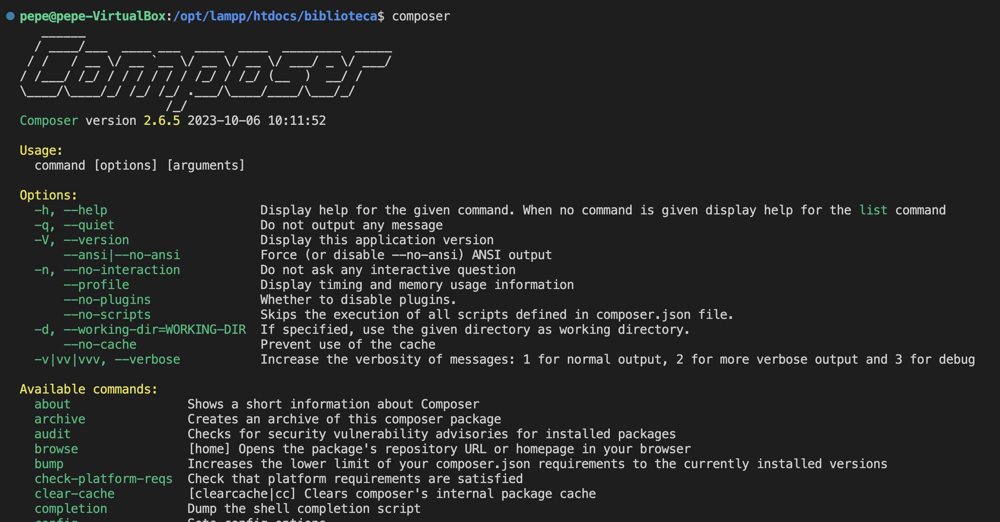
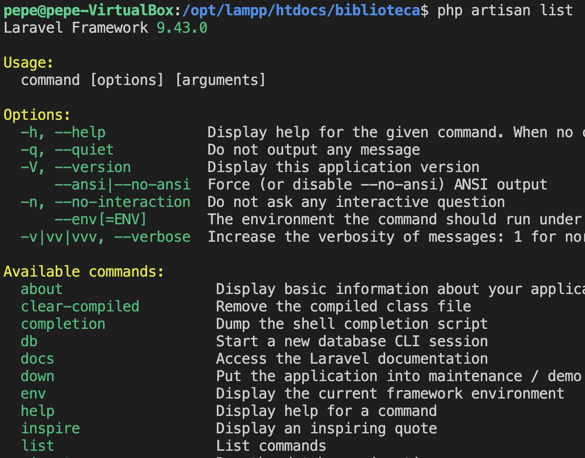
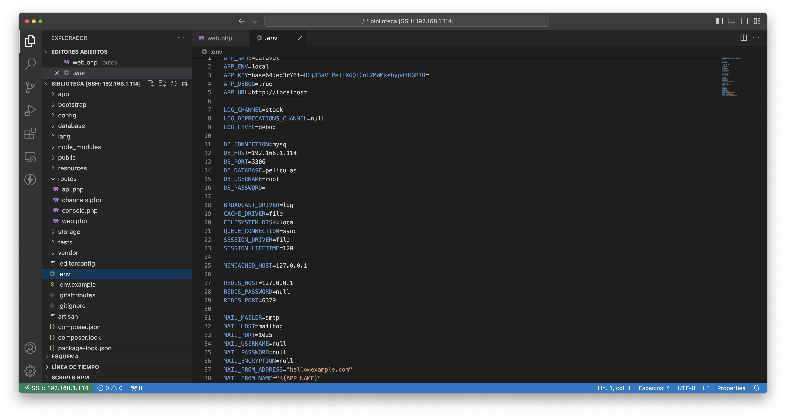
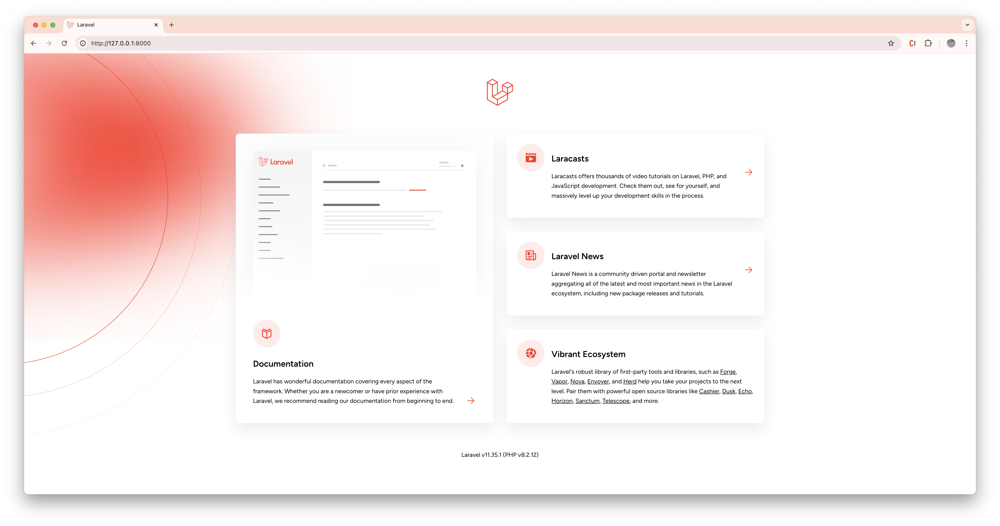

---
# Metainformació del document
title: Laravel 
titlepage: true
subtitle: Vida y Milagros
author:
- Pepe Devesa

...
# Pròleg
Un framework es una herramienta que proporciona una serie de módulos que ayudan a organizar y desarrollar un producto software. En el caso concreto de los frameworks PHP, la mayoría de ellos proporcionan una serie de comandos o herramientas para crear proyectos con una estructura determinada (normalmente, siguiendo el patrón MVC que veremos después), de forma que ya dan una base de trabajo hecha, y facilidades para poder crear el modelo de datos, la conexión a la base de datos, las rutas de las diferentes secciones de la aplicación, etc.

## Ejemplos de frameworks PHP

Actualmente existe una gran variedad de frameworks PHP que elegir para desarrollar nuestras aplicaciones. Algunos de los más populares son: 

* `Laravel`, un framework relativamente reciente (fue creado en 2011), y que ha ganado bastante popularidad en los últimos años. Su filosofía es el poder desarrollar proyectos de forma elegante y simple. Cuenta con una amplia comunidad de soporte detrás, y se le augura un futuro bastante consolidado. 

* `Symfony`, creado en 2005, cuenta con más camino hecho que Laravel, y una estructura más consolidada. En sus primeras versiones se presentaba como un framework más monolítico (se instalaban demasiados módulos que luego no necesitábamos), pero recientemente ha adaptado su estructura para hacerla más modular. De hecho, podríamos considerar Symfony como un metaframework, es decir, un framework que, a su vez, sirve para desarrollar otros frameworks. Prueba de ello es que, por ejemplo, Laravel utiliza Symfony como base para ampliar esas funcionalidades. 

* `CodeIgniter`, un framework más ligero que los anteriores, pero también con un amplio grupo de seguidores y desarrolladores. Fue creado en 2006 y, aunque ha sufrido una etapa de abandono, ha vuelto a coger fuerza en los últimos años, quizá debido a su simplicidad de uso. CakePHP, creado en 2005, es otro framework similar a CodeIgniter en cuanto a simplicidad y facilidad de uso, aunque con menor popularidad.

* `Zend`, creado en 2006, es otro framework bastante popular, aunque quizá con menor visibilidad que los anteriores hoy en día, a la altura de CakePHP. 

* `Phalcon`, otro framework de reciente creación (2012), con una potente capacidad de procesamiento de páginas PHP, y la posibilidad de trabajar como microframework (más ligero, para ofrecer funcionalidades muy específicas) o como framework completo. De hecho, muchos frameworks más antiguos también han incorporado recientemente la posibilidad de ejecutarlos como microframeworks. 

* ... etc.

## Software necesario
A la hora de trabajar con Laravel, necesitamos tener previamente instalados en nuestro sistema una serie de recursos software, como son: 

1. Un IDE (entorno de desarrollo) con el que editar el código de nuestros proyectos. Emplearemos `Visual Studio Code` en estos apuntes, aunque existen otras alternativas similares, como PHPStorm, Sublime Text, Atom, etc. 

2. Un servidor web que soporte PHP. En nuestro caso, utilizaremos `xampp`. 

3. Un servidor de bases de datos en el que almacenar la información de nuestras aplicaciones. Emplearemos un servidor MariaDB/MySQL, `phpmyadmin`. 

4. PHP actualizado a una versión compatible con la versión de Laravel que vayamos a utilizar. Por ejemplo, para Laravel versión 9 se necesita una versión de PHP 8.0 o posterior.

# Laravel
Para trabajar con Laravel, será necesario instalar el gestor de paquetes **composer** mediante el que podremos tanto crear proyectos Laravel como gestionar las dependencias de otros módulos en un proyecto.

## Instalando composer
Ésta es una herramienta muy habitual en ecosistemas PHP, y su labor es similar a la que desempeña el gestor NPM para aplicaciones JavaScript: gestionar las dependencias de un determinado proyecto, descargando, actualizando o desinstalando los paquetes necesarios. En este caso, lo utilizaremos para descargar e instalar el propio framework Laravel.

### Linux
Para instalar composer en Linux y Mac OSX, debemos descargar el archivo `composer.phar` de la web oficial y copiarlo renombrado a composer desde donde lo hayamos descargado a alguna carpeta que forme parte del PATH del sistema, y activarlo como ejecutable. Por ejemplo:

```bash
mv composer.phar composer 
sudo mv composer /usr/local/bin/composer 
sudo chmod +x /usr/local/bin/composer 
```
Como último paso, y ya que Composer utiliza el ejecutable de PHP, necesitamos que dicho ejecutable esté también en el PATH del sistema.

```bash
echo "export PATH=$PATH:/opt/lampp/bin" >> ~/.bashrc 
source ~/.bashrc 
```
### Comprobación de la instalación
Una vez instalado, podemos ejecutar el comando `composer` sin más en un terminal, y comprobar que muestra una salida con las opciones que ofrece:

{width=80%}

 ## Instalando Laravel

 A través de la herramienta `composer` se pueden crear directamente proyectos Laravel, como veremos en el curso. Sin embargo, la sintaxis del comando de creación es algo larga, si la comparamos con el instalador de Laravel, por lo que vamos a instalarlo también. Para hacerlo, usamos la propia herramienta composer , con este comando:

```bash
composer global require laravel/installer
```

En el caso de Windows, este comando ya deja el instalador laravel listo para poderse ejecutar desde terminal. Para Linux, deberemos añadirlo al PATH del sistema (en realidad, añadimos la carpeta con las utilidades que composer instala de forma global al sistema).


```bash
echo "export PATH=$PATH:$HOME/.config/composer/vendor/bin" >> ~/.bashrc 
source ~/.bashrc
```
##  Actualizando Laravel
En general, el comando laravel que se instala se encargará de crear proyectos empleando la última versión de Laravel que haya disponible. Así, si por ejemplo lo instalamos cuando aún existía la versión 7 de Laravel pero se publica la versión 8, automáticamente el comando laravel nos permitirá crear proyectos de la versión 8 desde ese punto. 
Sin embargo, es posible que con el tiempo se requiera actualizar el instalador para que los proyectos con nuevas versiones se sigan creando sin problemas. 
Para poder actualizar a la versión más reciente de Laravel, tenemos dos opciones, aunque es cierto que ninguna de ellas está recogida en la documentación oficial de Laravel, y lo que aquí se menciona se basa en recomendaciones de webs externas a Laravel. 
La primera forma de actualizar es utilizar el comando de actualización:

```bash
composer global update laravel/installer 
```
Sin embargo, esta opción puede no ser suficiente si el cambio es demasiado brusco (por ejemplo, pasar de Laravel 5 a Laravel 7), ya que algunas dependencias que también haya instaladas harían inviable el cambio. En este caso, podemos optar por quitar la versión instalada por completo, e instalar la reciente:

```bash
composer global remove laravel/installer 
composer global require laravel/installer 
```
Version actual:

```bash
Laravel Framework 9.43.0
```
Ahora que ya tenemos todo el sistema preparado para desarrollar proyectos Laravel, veamos los primeros pasos que debemos dar para crear estos proyectos.

# Crear proyectos Laravel
Para crear proyectos Laravel, tenemos dos alternativas: 

* Emplear el comando `laravel` que hemos instalado en sesiones anteriores mediante _composer_ 
* Utilizar el propio comando `composer`` para crear el proyecto. Esta opción será la recomendada si queremos crear proyectos con versiones de Laravel que no sean la última, o si por algún motivo no funciona la opción anterior.

##  Usando el comando laravel
Si empleamos el comando `laravel` para crear proyectos (asumiendo que ya lo tendremos instalado de la sesión de software necesario), nos deberemos ubicar en la carpeta donde queramos crear el proyecto y escribir este comando:

```bash
laravel new nombre_proyecto 
```
Por ejemplo, para las pruebas que iremos construyendo poco a poco en las siguientes sesiones, vamos a crear una web de libros, por lo que, en la carpeta donde queramos tener este proyecto, comenzamos escribiendo este comando:

```bash
laravel new biblioteca 
```
Esto creará un proyecto `biblioteca` en una subcarpeta con el mismo nombre.
## Usando el comando composer
Alternativamente, también se puede emplear la herramienta `composer` para crear el proyecto, usando la siguiente sintaxis (también desde la carpeta donde queramos ubicar el proyecto):

```bash
composer create-project --prefer-dist laravel/laravel nombre_proyecto
```
En nuestro caso, para el ejemplo de la biblioteca que vamos a ir desarrollando, escribiremos este comando:

```bash
composer create-project --prefer-dist laravel/laravel biblioteca 
```
Del mismo modo que en el caso anterior, se creará una carpeta `biblioteca` con el contenido inicial del proyecto dentro, empleando la última versión de Laravel disponible.

##  Crear proyectos Laravel usando versiones anteriores
Al crear un proyecto con el comando `laravel new`, se creará con la última versión disponible de Laravel. 
En el caso de que necesitemos crear un proyecto Laravel que no utilice la última versión, sino alguna anterior, necesitamos utilizar la herramienta composer para especificar el número de versión de Laravel que queremos utilizar. 
Por ejemplo, este comando crea un proyecto llamado "prueba" utilizando Laravel 7:

```bash
composer create-project --prefer-dist laravel/laravel prueba 7.x 
```
## Puesta en marcha en carpeta predefinida de XAMPP
Si nuestro proyecto se llama `biblioteca` y queremos moverlo a esta carpeta en Linux, escribimos este comando desde la carpeta que contiene nuestro proyecto:

```bash 
sudo mv biblioteca /opt/lampp/htdocs 
```
A continuación debemos poner en marcha el servidor Apache (empleando el manager de XAMPP), y luego acceder a la URL. Obtendremos la misma página de inicio que en el caso anterior.

## El comando `artisan`

Cuando se crea un proyecto Laravel, se instala una herramienta llamada `artisan` en la raíz del proyecto. Es una interfaz de línea de comandos (CLI, Command Line Interface), que proporciona una serie de opciones adicionales que nos vendrán bien en nuestra gestión de proyectos Laravel para, por ejemplo, crear controladores, migrar datos a una base de datos, etc. 
Para comprobar que está instalada y las opciones que ofrece, podemos escribir el siguiente comando en un terminal desde la carpeta del proyecto que hayamos creado:

```php
php artisan list
```
{width=80%}

##  Laravel y Visual Studio Code

Como hemos comentado, podemos gestionar muy cómodamente los proyectos Laravel desde el IDE Visual Studio Code. Basta con abrir la carpeta principal del proyecto desde el propio IDE, y eso puede hacerse desde el menú `Archivo > Abrir Carpeta`, o bien arrastrando la carpeta a la zona principal del IDE, e incluso, dependiendo de cómo hayamos hecho la instalación, también podemos hacer clic derecho sobre la carpeta del proyecto en el explorador de archivos, y elegir Abrir con Code en el menú contextual. Una vez abierto, tendremos la estructura del proyecto en la parte izquierda (pestaña de explorador de archivos), y podremos ir editando los archivos en la parte derecha.


{width=80%}

# Estructura de un proyecto Laravel

 Los proyectos Laravel se pueden gestionar abriendo la carpeta directamente desde nuestro IDE (Visual Studio Code). Cuando creamos un proyecto Laravel, se crea una estructura de carpetas y archivos predefinida. Explicamos ahora brevemente en qué consisten las principales carpetas y archivos que se generan.
 
## Elementos Principales de Laravel (MVC)

| Carpeta / Archivo | Elemento MVC | Descripción |
| :--- | :--- | :--- |
| `app/Models/` | **Modelo (M)** | Modelos de la base de datos. Ej: `User.php`. |
| `resources/views/` | **Vista (V)** | Plantillas Blade que generan el HTML. |
| `app/Http/Controllers/` | **Controlador (C)** | Lógica que maneja las peticiones HTTP. |
| `routes/web.php` | **Enrutador / Rutas** | Archivo donde se definen las rutas para clientes web. |

# Estructura Completa de Archivos y Carpetas en Laravel

## Otras carpetas y archivos importantes

| Carpeta/Archivo | Descripción detallada |
| :--- | :--- |
| `app/` | Contiene la lógica de la aplicación: controladores, modelos, middleware. |
| `bootstrap/` | Carga inicial de la aplicación. Incluye `app.php`. |
| `config/` | Archivos de configuración de todo el sistema: base de datos, correo, sesiones, etc. |
| `database/` | Contiene migraciones, seeders y fábricas de datos para pruebas. |
| `public/` | Carpeta pública servida por Nginx. Contiene `index.php`, CSS, JS públicos. |
| `storage/` | Archivos generados automáticamente: logs, caché, ficheros temporales, subidas de usuarios. |
| `tests/` | Tests unitarios y funcionales para automatizar comprobaciones del proyecto. |
| `.env` | Archivo oculto que define las variables de entorno (configuraciones sensibles). |
| `vendor/` | Carpeta generada por Composer que contiene todas las dependencias del proyecto. |
| `artisan` | Comando CLI propio de Laravel para realizar tareas de desarrollo dentro del proyecto. |
| `composer.json` | Archivo que define todas las dependencias PHP del proyecto (gestor Composer). |

---

## Desglose de Subcarpetas Principales

### Dentro de `app/`

| Carpeta/Archivo | Descripción |
| :--- | :--- |
| `Http/` | Contiene controladores y middleware. |
| `Models/` | Contiene los modelos de la base de datos. |
| `Console/` | Contiene comandos personalizados de Artisan. |

### Dentro de `config/`

| Carpeta/Archivo | Descripción |
| :--- | :--- |
| `app.php` | Configuración de la aplicación. |
| `database.php` | Configuración de la base de datos. |
| `mail.php` | Configuración del correo electrónico. |
| `session.php` | Configuración de sesiones. |
| `auth.php` | Configuración de autenticación. |

### Dentro de `database/`

| Carpeta/Archivo | Descripción |
| :--- | :--- |
| `migrations/` | Archivos que definen la estructura de las tablas de la base de datos. |
| `seeders/` | Archivos que permiten poblar la base de datos con datos iniciales. |
| `factories/` | Archivos que permiten crear datos de prueba para los modelos. |

### Dentro de `storage/`

| Carpeta/Archivo | Descripción |
| :--- | :--- |
| `app/` | Archivos subidos por los usuarios. |
| `framework/` | Archivos generados automáticamente por Laravel. |
| `logs/` | Archivos de registro de errores y eventos. |

### Dentro de `tests/`

| Carpeta/Archivo | Descripción |
| :--- | :--- |
| `Feature/` | Tests funcionales que comprueban el comportamiento de la aplicación. |
| `Unit/` | Tests unitarios que comprueban la lógica de los modelos y controladores. |

### Dentro de `public/`

| Carpeta/Archivo | Descripción |
| :--- | :--- |
| `css/` | Archivos CSS públicos. |
| `js/` | Archivos JavaScript públicos. |
| `index.php` | Punto de entrada a la aplicación. |
| `favicon.ico` | Icono de la página web. |
| `robots.txt` | Archivo que indica a los motores de búsqueda qué páginas indexar. |
| `htaccess` | Archivo de configuración de Apache (no usado en nuestro caso). |


## Configuración general del proyecto.
De entre la estructura de carpetas de un proyecto Laravel vista anteriormente, echaremos ahora un rápido vistazo a dónde se encuentra la configuración general del proyecto. Por un lado, disponemos de un archivo `.env` en la raíz del proyecto, que básicamente contiene una serie de variables de entorno generales. Por ejemplo, se tiene la variable `APP_NAME` con el nombre que queremos que tenga la aplicación, o un conjunto de variables que utilizaremos más adelante para conectar con la base de datos, entre otras cosas:

```php
DB_CONNECTION=mysql
DB_HOST=127.0.0.1
DB_PORT=3306
DB_DATABASE=biblioteca
DB_USERNAME=root
DB_PASSWORD=
```
En general, los cambios de configuración es preferible hacerlos en este archivo `.env` , de forma que en los archivos de la carpeta config accederemos a estas variables de entorno definidas en env. Por ejemplo, podemos definir las propiedades del archivo .env de este modo para el proyecto biblioteca que hemos creado anteriormente.

Por otra parte, la carpeta `config` contiene unos archivos generales de configuración. Iremos viendo algunos de ellos en sesiones posteriores, pero, para empezar, podemos echar un vistazo al archivo `config/app.php`, que contiene parámetros de configuración general de la aplicación. Por ejemplo, podemos modificar el nombre de la aplicación, en la propiedad `name` , aunque, como vemos, el nombre lo coge de la propiedad `APP_NAME` del archivo `.env`.

```php
 'name' => env('APP_NAME', 'Laravel')
```
Es más habitual modificar los valores del archivo `.env` que los que hay en este archivo de configuración. Pero, en algunos casos, sí convendrá acudir a alguno de los archivos de esta carpeta y modificar la información que contiene.

## Permisos en carpetas del proyecto
Para poder probar nuestro proyecto Laravel, además de configurar y poner en marcha el servidor correspondiente es necesario habilitar permisos de acceso y escritura a ciertas carpetas del proyecto, especialmente en sistemas Linux, si movemos el proyecto a una carpeta con permisos reducidos. 

* Carpeta `storage` junto con sus subcarpetas y contenidos. En esta carpeta se compilarán las vistas, se generarán los archivos de log, etc, por lo que conviene que esta carpeta tenga permisos de **escritura**. 

* Subcarpeta `bootstrap/cache` , donde se almacenará la caché de los archivos ya cargados. Para habilitar los permisos en estas carpetas bajo Linux o Mac OSX, podemos ejecutar estos comandos desde la raíz del proyecto (la opción -R aplica los permisos de forma recursiva):

```bash
sudo chmod -R 777 bootstrap/cache 
sudo chmod -R 777 storage 
sudo chmod -R 777 storage/logs 
```
# Puesta en marcha con el comando artisan
La forma más sencilla de probar nuestro proyecto es a través del comando `artisan` . Nos ubicamos en la carpeta raíz del proyecto (recuerda que esto se puede hacer automáticamente abriendo la carpeta con Visual Studio Code y abriendo su terminal), y ejecutamos este comando:

```bash
osboxes@osboxes:/opt/lampp/htdocs/biblioteca$ php artisan serve

   INFO  Server running on [http://127.0.0.1:8000].  

  Press Ctrl+C to stop the server
```
Para poner en marcha el servidor remoto(nuestro caso):

```bash
osboxes@osboxes:/opt/lampp/htdocs/proveedores$ php artisan serve --host=192.168.1.116

   INFO  Server running on [http://192.168.1.116:8000].  

  Press Ctrl+C to stop the server
```
Con la ip particuler de cada equipo...

Conectando a la URL que se nos facilita, veremos la pantalla de inicio de nuestro proyecto, que será algo así (aunque el diseño de la página de inicio puede variar dependiendo de la versión de Laravel que usemos):


{width=80%}


:::  note

   Si nuestra aplicación necesita acceder a una base de datos, además de arrancarla con el comando artisan visto antes, también tendremos que tener en marcha el servidor de bases de datos correspondiente, a través del manager de XAMPP.

:::
:::  note

   En el caso de una puesta en producción real, o si queremos dejar una aplicación correctamente configurada con Apache, hay que realizar una serie de pasos previos, tales como asociarlo a un virtual host (de Apache, en nuestro caso). 
   Estos pasos no los veremos.

:::
# Node.js

A pesar de que podría parecer que Node.js es un ecosistema diferente a Laravel, lo cierto es que con la instalación de Node se incorpora una herramienta muy útil en cualquier aplicación web que utilice librerías JavaScript, como puedan ser Bootstrap o jQuery. Es la herramienta **NPM (Node Package Manager)**, que permite instalar de forma sencilla estas librerías en cualquier proyecto.

**Versión requerida:** es recomendable tener instalada la última versión LTS (Long Term Support). En la última versión de estos apuntes, dicha versión es la `16.x`.

Para instalar Node en cualquiera de los sistemas que estamos contemplando (Linux, Windows o Mac OSX) podemos optar por:

*   Instalarlo a través del instalador correspondiente.

*   Utilizar la herramienta **NVM (Node Version Manager)**. Esta herramienta nos va a permitir tener más de una versión de Node instalada, y poder elegir en todo momento cuál de ellas es la que queremos tener activa.

:::tip

**Nota:** En el caso de Windows, la herramienta NVM que podemos utilizar no es la “oficial”, pero sí existe una especie de clon alternativo funcional.

:::
---

## 5.1. Instalación en Linux

En el caso de distribuciones Linux, como es el caso de la máquina virtual proporcionada, podemos optar por ejecutar un instalador o por usar NVM. En la versión completa de la máquina virtual proporcionada se ha optado por esta última opción (NVM), pero damos aquí los pasos a seguir para ambas opciones.

### Opción de instalador
Si optamos por instalar Node.js a través de un instalador, los pasos a seguir son:

1. En primer lugar, si no tenemos instalada la herramienta `curl`, la instalamos con:
   ```bash
   sudo apt-get install curl
   ```
2. Después, utilizamos `curl` para recuperar la versión de Node que queramos (versión LTS actual, `16.x`):
   ```bash
   curl -sL https://deb.nodesource.com/setup_16.x | sudo -E bash -
   ```
3. Finalmente, instalamos Node.js:
   ```bash
   sudo apt-get install -y nodejs
   ```

Si quisiéramos actualizar la versión de Node.js en un futuro, bastaría con repetir los dos últimos comandos, poniendo en el paso 2 la versión a obtener en este caso.

### Opción de NVM
Podemos consultar información de esta herramienta en su web oficial en GitHub. Para instalarla, debemos descargarla con el comando `curl` o `wget`, según se explica en la propia web de GitHub.

Si optamos por `wget`, el comando es como sigue (en una sola línea):
```bash
wget -qO- https://raw.githubusercontent.com/nvm-sh/nvm/v0.39.1/install.sh | bash
```

En el caso de no disponer del comando `wget` instalado, podemos o bien instalarlo, o bien emplear este otro comando equivalente, con la orden `curl` (también en una sola línea):
```bash
curl -o- https://raw.githubusercontent.com/nvm-sh/nvm/v0.39.1/install.sh | bash
```

::tip
 **NOTA:** El número de versión `v0.39.1` puede variar. Es preferible consultar la web de GitHub para obtener el comando actualizado.
 **NOTA:** Después de ejecutar el comando anterior, será necesario cerrar el terminal y volverlo a abrir para poder utilizar el comando `nvm`. Si sigue sin reconocer el comando, quizá debamos actualizar con `source ~/.bashrc`.
:::

---

## 5.2. Instalación en Mac OSX

Para distribuciones Mac OSX, tenemos igualmente la opción de usar un instalador o la herramienta NVM.

### Opción de instalador
El instalador de Node.js para Mac OSX es muy sencillo. Lo descargamos de la web oficial de Node y lo lanzamos. Si queremos actualizar versión en un futuro, basta con volver a descargar esa última versión y lanzar el instalador correspondiente para actualizarla.

### Opción NVM
Para utilizar NVM en Mac OSX seguimos los mismos pasos que para Linux, comentados anteriormente, pero en este caso para actualizar el terminal ejecutaremos:
```bash
source ~/.bash_profile
```

---

## 5.3. Instalación en Windows

### Opción de instalador
El instalador de Node.js para Windows es igualmente muy sencillo. Lo descargamos de la web oficial de Node y lo lanzamos. Si queremos actualizar versión en un futuro, basta con volver a descargar esa última versión y lanzar el instalador correspondiente para actualizarla.

### Opción NVM
Como comentábamos, la herramienta NVM oficial sólo está disponible para sistemas Unix, por lo que funciona en Linux y Mac OSX, pero no en Windows. Como alternativa, existe alguna implementación paralela de nvm que podemos hacer servir, como [esta](https://github.com). 

Podemos descargar un instalador (`nvm-setup.zip`) y ejecutarlo para instalar este gestor. Después, desde línea de comandos tendremos disponibles una serie de comandos para gestionar las versiones de Node, como veremos a continuación.

---

## 5.4. Utilizando NVM

Si hemos optado por instalar Node a través de `nvm`, tendremos disponibles una serie de comandos en el terminal para instalar y gestionar las versiones de Node. Aquí resumimos los más importantes.

### Linux y Mac OSX
En el caso de estos sistemas, habremos instalado la versión oficial de NVM, y los comandos que podemos utilizar son estos:

*   `nvm install node`: Instala la última versión disponible de Node.
*   `nvm install --lts`: Instala la última versión LTS disponible.
*   `nvm install 12.16.0`: Instala la versión especificada de Node.
*   `nvm uninstall 12.16.0`: Desinstala la versión especificada de Node.
*   `nvm ls-remote`: Muestra todas las versiones disponibles para instalar.
*   `nvm list`: Muestra todas las versiones instaladas localmente.
*   `nvm current`: Muestra la versión actualmente activa.
*   `nvm use 12.16.0`: Marca la versión indicada como actualmente activa.
*   `nvm use --lts`: Marca como activa la última versión LTS instalada.

En nuestro caso, vamos a instalar la última versión LTS disponible, ya que éstas son las versiones que tienen soporte a largo plazo. Por lo tanto, ejecutaremos los comandos:
```bash
nvm install --lts
nvm use --lts
```

:::note

 **NOTA:** El comando `nvm use` normalmente no es necesario, ya que la instalación automáticamente deja como activa la versión que elegimos. Pero si el terminal no termina de reconocer el comando `node` puede ser necesario ejecutarla.
:::

### Windows
En el caso de Windows con la versión alternativa de NVM, los comandos son ligeramente diferentes:

*   `nvm install 12.16.0`: Instala la versión especificada de Node.
*   `nvm uninstall 12.16.0`: Desinstala la versión especificada de Node.
*   `nvm list`: Muestra todas las versiones instaladas localmente.
*   `nvm list available`: Muestra todas las versiones disponibles para instalar con esta adaptación de NVM.
*   `nvm use 12.16.0`: Marca como activa la versión de Node especificada (previamente instalada).

Para instalar la versión LTS disponible, tendremos que ver su número en la web oficial de Node, y luego ejecutar el comando correspondiente. Por ejemplo:
```cmd
nvm install 16.16.0
nvm use 16.16.0
```

---

## 5.5. Prueba de Node

Podemos ejecutar ahora el siguiente comando en el terminal y comprobar que nos muestra el número de versión adecuado:
```bash
node -v
```

También podemos ejecutar el comando para comprobar la versión que se ha instalado del gestor NPM (que no tiene por qué coincidir con la de Node):
```bash
npm -v
```
